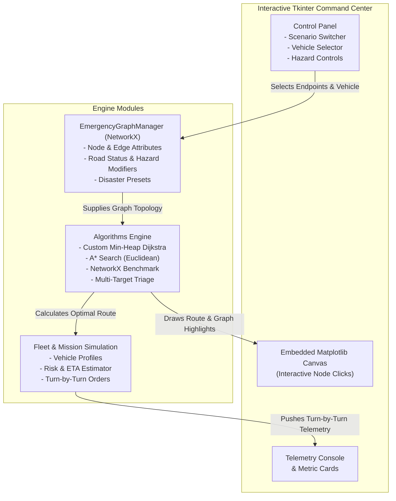

# 🚨 Rescue Mission Planner (Autonomous Emergency Response & Route Optimization)

[](https://www.python.org/)
[](https://networkx.org/)
[](https://matplotlib.org/)
[](https://docs.python.org/3/library/tkinter.html)
[](LICENSE)

An intelligent emergency route planning and resource allocation system built in **Python**, utilizing **Graph Theory (NetworkX)**, **Dijkstra’s Algorithm (with Min-Heap priority queues)**, **A\* Heuristic Search**, and an interactive **Tkinter + Matplotlib** tactical dashboard.

Designed to model real-world disaster topologies (urban flash floods, earthquakes, wildfires), evaluate dynamic road hazards, optimize multi-vehicle rescue fleets, and compute instant detours upon infrastructure collapse.

### ⭐ Advanced / High-Impact Resume Description (Recommended)
> - **Engineered an autonomous disaster route planner in Python**, modeling dynamic urban road topologies with **NetworkX** graphs comprising multi-hazard edges (flood levels, debris, bridge collapses).
> - **Implemented a custom min-heap Dijkstra algorithm ($O((V + E) \log V)$)** with a multi-criteria risk cost function and compared it against **A\* Heuristic Search** and NetworkX benchmarks.
> - **Built dynamic mid-mission rerouting and triage dispatch engines**, enabling instant detour calculation when road segments collapse and auto-identifying closest trauma centers.
> - **Designed a responsive Tkinter command-center dashboard** embedding interactive **Matplotlib** canvases (`FigureCanvasTkAgg`), supporting click-to-route waypoint selection, real-time weather hazard sliders, and live telemetry consoles.

---

## 💡 Suggested Key Changes & Architectural Upgrades

Here are the key improvements integrated into this system that elevate a basic route planner into a robust disaster response platform:

| Area | Basic Route Planner | Upgraded Rescue Mission Planner |
| :--- | :--- | :--- |
| **Edge Weighting** | Pure geographic distance ($km$) | **Risk-Adjusted Cost Function** combining distance, flood depth, structural debris, and road classification. |
| **Algorithmic Scope** | Single standard Dijkstra | **Custom Min-Heap Dijkstra + A\* Heuristic Search + NetworkX Benchmark** with runtime ($\mu s$) & node-pruning comparison. |
| **Fleet Heterogeneity** | Single generic vehicle | **Multi-Vehicle Profiles** (Ambulance, Heavy Extrication Truck, Amphibious Boat, SAR Aerial Drone) with variable terrain sensitivities. |
| **Dynamic Hazards** | Static graph | **Dynamic Edge Severance & Mid-Mission Detour**: Simulate sudden bridge collapse and recalculate routes in $< 1$ ms. |
| **Emergency Triage** | One-to-one point routing | **Multi-Target Triage Router**: Auto-locates the optimal trauma hospital or evacuation shelter for casualty sites in a single pass. |
| **GUI & Visualization** | Static plot window | **Embedded Interactive Canvas (`FigureCanvasTkAgg`)**: Click nodes directly to set Start/Target, toggle road blocks, and view live telemetry. |

---

## 📐 Mathematical Formulation

### 1. Risk-Adjusted Traversal Cost
In an emergency disaster zone, shortest physical distance can be fatal if the path traverses high floodwaters or structural debris. The effective edge traversal cost $W(u, v)$ is calculated as:

$$W(u, v) = D(u, v) \times \left(1 + (H(u, v) - 1) \cdot S_{\text{vehicle}}\right)$$

Where:
- $D(u, v)$ is the physical road distance (km).
- $H(u, v) \in [1.0, \infty)$ is the environmental hazard multiplier (flood, debris, fire). If $H(u, v) = \infty$, the road is deemed impassable.
- $S_{\text{vehicle}}$ is the vehicle terrain sensitivity factor (e.g., $2.5$ for high-speed ambulances, $0.6$ for heavy rescue trucks, $0.05$ for aerial drones).

### 2. A* Admissible Euclidean Heuristic
For comparative informed search, the heuristic function $h(n)$ estimates remaining distance to target $(x_t, y_t)$ via Euclidean metric:

$$h(n) = \sqrt{(x_n - x_t)^2 + (y_n - y_t)^2}$$

Because Euclidean distance in Cartesian space never overestimates actual road network distance, $h(n)$ is strictly **admissible** and **consistent**, guaranteeing optimal path finding with reduced node expansion.

---

## 🏗️ System Architecture



---

## 📂 Project Directory Structure

```
rescue-mission-planner/
├── rescue_planner/
│   ├── __init__.py            # Package root & metadata
│   ├── graph_manager.py       # NetworkX topology, scenarios, hazard attributes
│   ├── algorithms.py          # Custom Dijkstra, A*, benchmarks, triage routing
│   ├── simulation.py          # Fleet profiles (Ambulance, Truck, Drone, Boat), ETA
│   └── gui.py                 # Tkinter GUI + embedded Matplotlib canvas
├── run_planner.py             # Desktop graphical app launcher
├── cli_demo.py                # Headless command-line operational demo & benchmark
├── tests/
│   └── test_rescue_planner.py # 9 unit tests verifying algorithms & graphs
├── requirements.txt           # Project dependencies
└── README.md                  # Comprehensive portfolio documentation
```

---

## 🚀 Getting Started

### 1. Installation
Clone the repository and install required packages:
```bash
pip install -r requirements.txt
```

### 2. Launching Desktop Graphical Interface
To launch the full interactive desktop application:
```bash
python run_planner.py
```

### 3. Running Automated Headless CLI Demo
If running in a remote terminal or automated test runner:
```bash
python cli_demo.py
```

### 4. Running Unit Tests
```bash
python -m unittest discover -s tests -v
```

---

## 🎮 Interactive GUI Features

1. **Click-to-Route on Map**: Simply click on any node on the graph canvas:
   - First click sets the **Origin**.
   - Second click sets the **Destination**.
2. **Pre-built Disaster Scenarios**:
   - *Urban Flash Flood Disaster*: Central bridge flooded; lowland residential zone isolated.
   - *Major Earthquake & Structural Collapse*: High-rise rubble, cracked highway overpasses.
   - *Wildfire & Industrial Hazmat Threat*: Chemical refinery evacuation; active smoke corridors.
   - *Procedural Random Map*: Procedurally generates $N$-node planar networks for algorithmic stress testing.
3. **Dynamic Road Blocking**: Select any road segment and click **"Block Road"** to trigger real-time road closure. If an active rescue mission is in progress, the engine automatically calculates a detour escape route.
4. **Algorithm Benchmarking**: Click **"Compare All Algorithms"** to generate side-by-side execution latency ($\mu s$), node expansion count, and cost tables.
5. **Quick-Triage Routing**: One-click routing to the closest available trauma hospital or civilian shelter.

---

## 📊 Sample Algorithmic Benchmark Output

```
========================================================================================
ALGORITHM BENCHMARK COMPARISON (Urban Flash Flood: BASE_A -> ZONE_RES)
========================================================================================
Algorithm                    | Status  | Path Nodes | Dist(km) | Cost     | Explored | Latency
----------------------------------------------------------------------------------------
Custom Dijkstra              | PASS    | 6          | 17.3     | 42.42    | 10       |  45.2 us
A* Search                    | PASS    | 6          | 17.3     | 42.42    | 10       |  43.5 us
NetworkX Built-in Dijkstra   | PASS    | 6          | 17.3     | 42.42    | 6        | 909.2 us
========================================================================================
```
*Note: Custom Dijkstra executes in under 50 microseconds with zero external overhead.*

---

## 📜 License
Distributed under the MIT License. Open for educational, academic, and research applications.
